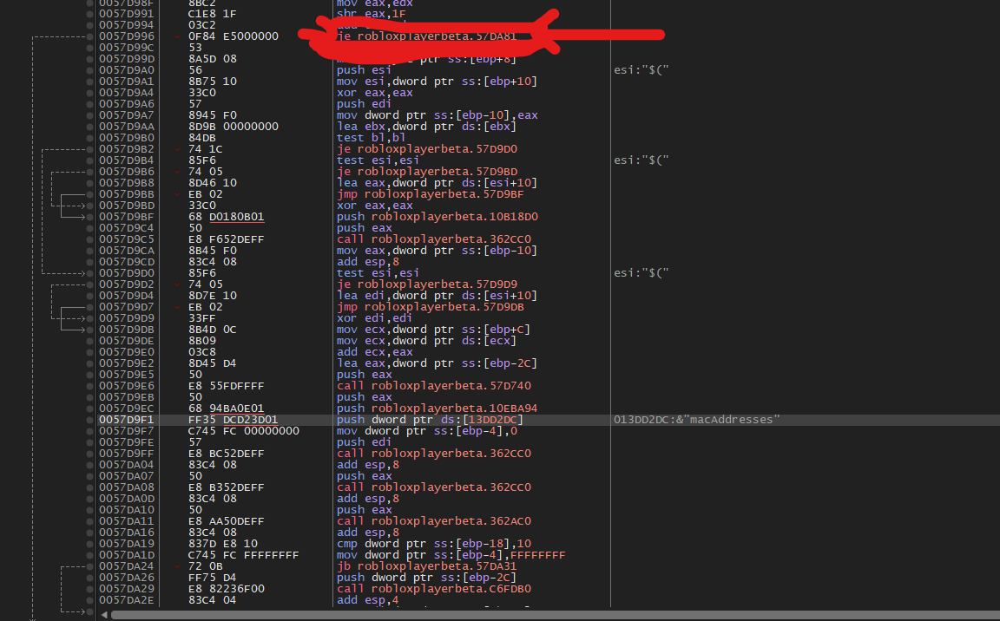

# Client Patching: Stop Sending MAC Addresses

*Credits: s3dcat. Targets Windows clients from 2016 onward. From ORC Guide.*

This patch prevents a client from sending `macAddresses` with the `/game/validate-machine` request.

1. Open `RobloxPlayerBeta.exe` in x32dbg and wait for analysis to finish.
2. Open string references and search for `macAddresses`.
3. Open the result and locate the nearby `JE` instruction.
4. Change the conditional jump to `JMP`.
5. Choose **File > Patch File**, then save the executable.

[Original note](/vault/discord/orc-guide/guides/mac-address-api-prevention.txt)
