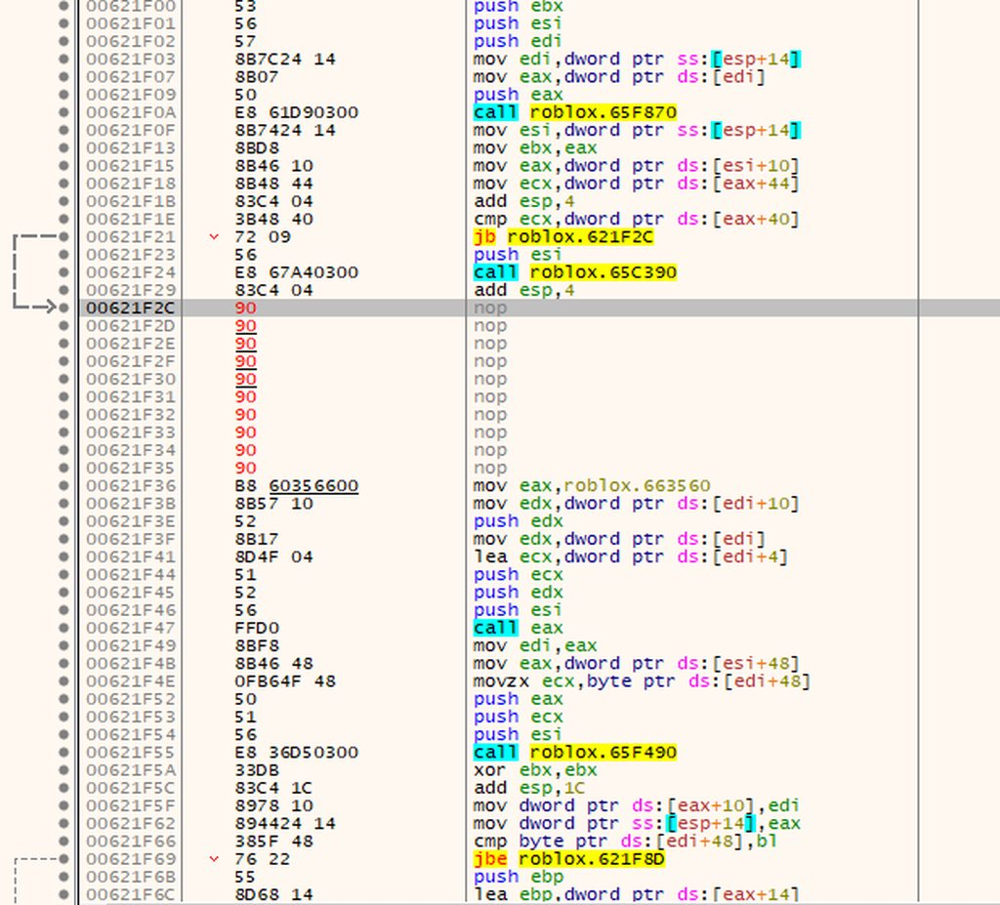

# Bytecode Patching (2007-2009)

*Credits: ORC guide server community*

## Test if Client is Vulnerable

Open client, Ctrl+N for new place. In command bar:

```lua
loadstring("\27\76\117\97\81\0\1\4\4\4\8\0\14\0\0\0\76\117\97\67\88\88\32\83\111\117\114\99\101\0\1\0\0\0\1\0\0\0\0\0\0\4\4\0\0\0\5\0\0\0\65\64\0\0\28\64\0\1\30\0\128\0\2\0\0\0\4\6\0\0\0\112\114\105\110\116\0\4\4\0\0\0\97\98\99\0\0\0\0\0\0\0\0\0\0\0\0\0\0\0\0\0")()
```

If it returns "abc", it is unpatched. If it errors with "attempt to call a nil value", it is already patched.

## How to Patch

1. Open client in x32dbg
2. Symbols > double-click module (roblox.exe)
3. Click [A₂] icon (string search)
4. Search "binary string"
5. Double-click result > disassembler
6. Find `call roblox.MEMORYADDRESS` and double-click
7. Change `sub esp, 0x18` to `ret`
8. Band-aid icon > Patch File > save as .exe

## Trace the bytecode parser

*Credits: mugny; Coke is credited by mugny. The client version is not specified.*

1. Run the client, create a place, and attach x32dbg to the client process.
2. In **Memory Map**, open the client's `.text` section in the disassembler.
3. Search the string references for `binary string` and open the matching code.
4. Find `luaU_undump` and set a breakpoint at its first instruction.
5. In the client's command bar, run `loadstring('\\27')()`.
6. When the breakpoint hits, inspect the last call in the call stack. The post identifies it as `f_parser`.
7. The post's exported screenshot shows the patch location:

   

The export contains one of the two images referenced in the original post, so the screenshot may not show the complete change.
