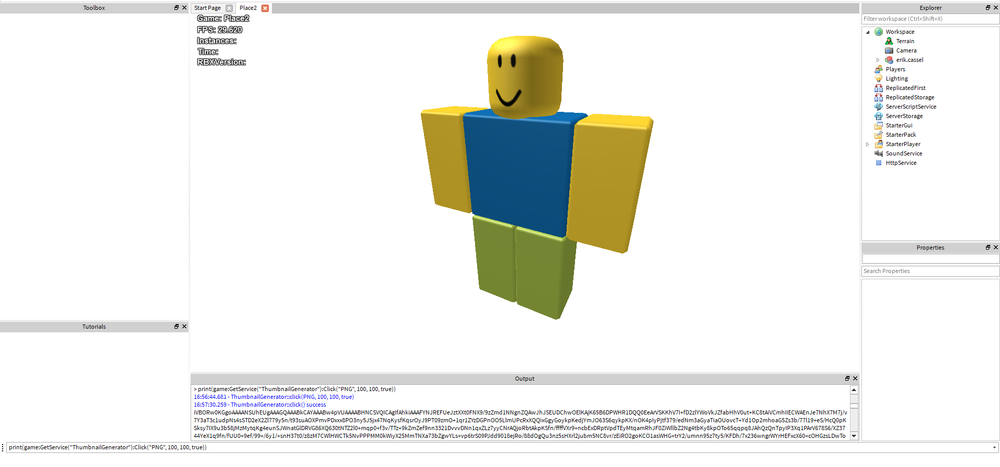

# Roblox Client and Studio Archives

*Credits: ChromeAdders (complete archive); other creators and contributors are listed per resource. Resource notes from ORC Guide and Roblox Revival Helpers.*

## Complete client archive

[ChromeAdders' Google Drive archive](https://drive.google.com/drive/folders/1XZpSoJGEsxC2UkKiypm_hIpU2yV4au9q?usp=sharing) contains Player and Studio builds from 2007-2018, including BloxxCon Virtual and FIB v9. The archive entry lists Studio builds after 2012 but no Player clients.

## Client and Studio builds

| Resource | Credit | Link |
|---|---|---|
| Modified February 2018 UWP client | watrabi | [MediaFire ZIP](https://www.mediafire.com/file/8uacnzdxpxcwlnu/ROBLOXCorporation.ROBLOX_2.323.46688.0_x86__55nm5eh3cm0pr.zip/file) |
| 2007 repatch | ! Vand | From ORC Guide |
| 2022 PDB archive | Hadi | [MEGA archive](https://mega.nz/file/8zkjHRLK#J_ldpe4kbTD7DMjpn7ro9ZLJTBSdOJR--Jtd6Wq82Vk) |
| 2009 character content for the 2012 client | vmultrawarefan | [Archive and previews](/article.php?path=resources%2F2009-character-content) |
| 2016 Studio build with `ThumbnailGenerator` restored | vmultrawarefan | [MediaFire archive](https://www.mediafire.com/file/lfxwi2xe4ytfmjw/version-studio.7z/file), [screenshot](/vault/discord/orc-guide/client/v0jzjpf.png), From ORC Guide |
| 2022 Studio client with PDB | al_ex427, shared by vmultrawarefan | From ORC Guide |
| Xbox clients, 2018-2024 | LuaWiz, EmK530, and other dump contributors; shared by watrabi | [Gofile archive](https://gofile.io/d/zPD64j), From ORC Guide |
| macOS Studio with debug symbols, x64 | vmultrawarefan | [Wayback capture](https://web.archive.org/web/20260820175830/https://setup.rbxcdn.com/mac/version-e13de4601948480e-RobloxStudioApp.zip), From ORC Guide |
| macOS Studio with debug symbols, arm64 | h6di | [Wayback capture](https://web.archive.org/web/20260820192520/https://setup.rbxcdn.com/mac/arm64/version-e13de4601948480e-RobloxStudioApp.zip), From ORC Guide |

The macOS archive links point to captures of a build described as dating from around August 14, 2026. The Xbox post later requested that Gofile files not be reuploaded; the original link is listed without mirroring the files.

## Setup and deployment files

| File | Date noted in post | Archive |
|---|---|---|
| `Roblox.cab` | November 2009 | [Wayback capture](https://web.archive.org/web/20160925175242/http://setup.roblox.com/Roblox.cab) |
| `Roblox.exe` | 2011 | [Wayback captures](https://web.archive.org/web/20240421121103*/http://setup.roblox.com/Roblox.exe) |
| `RobloxStudioLauncherBeta.exe` | July 2013 | [setup.roblox.com](http://setup.roblox.com/RobloxStudioLauncherBeta.exe) |
| `RobloxStudioLauncher.exe` | December 2013 | [setup.roblox.com](http://setup.roblox.com/RobloxStudioLauncher.exe) |
| `Roblox.cab` | 2016 | [Wayback captures](https://web.archive.org/web/20240421121313*/http://setup.roblox.com/Roblox.cab) |
| `version-09a201d8e5f247c7-content-textures.zip` | September 18, 2015 | [Wayback capture](https://web.archive.org/web/20150918090750/http://setup.roblox.com/version-09a201d8e5f247c7-content-textures.zip) |
| `RCC-RobloxA5XGEOZ35LAFQUL2.exe` | 2022 | [Wayback captures](https://web.archive.org/web/20230110211448*/http://setup.roblox.com/RCC-RobloxA5XGEOZ35LAFQUL2.exe) |
| `RobloxStudioLauncherBetaCJV.exe` | May 2022 | [setup.roblox.com](http://setup.roblox.com/RobloxStudioLauncherBetaCJV.exe) |
| `DeployHistory.txt`, `zreleasevs2019` | February 2023 | [Wayback capture](https://web.archive.org/web/20230216095332/https://setup.roblox.com/channel/zreleasevs2019/DeployHistory.txt) |

The dates are labels from ORC Guide and may not match the linked capture dates.

## Deployment history

- [AndroDome Deploy History](https://androdome.com/DeployHistory/)
- [Current zlive deployment history](https://setup.rbxcdn.com/channel/zlive/DeployHistory.txt)
- [Current zlive macOS deployment history](https://setup.rbxcdn.com/channel/zlive/mac/DeployHistory.txt)

ORC Guide shared the `zlive` lists as inputs for finding 2020L-2022L clients with [Roblox Deployment Downloader](/article.php?path=resources%2Froblox-deployment-downloader).

## Related archives

- [GT2 Stuff Archive](/article.php?path=resources%2Fgt2-stuff-archive), maintained by NukaWorks Solutions.
- [RCC and RBXGS Archives](/article.php?path=resources%2Frcc-archives).
- [Roblonium Archive](/article.php?path=resources%2Froblonium-archive).
- [Android and iOS version spreadsheets](/article.php?path=resources%2Fversion-spreadsheets).
- [GT2 Stuff Archive](/article.php?path=resources%2Fgt2-stuff-archive).
